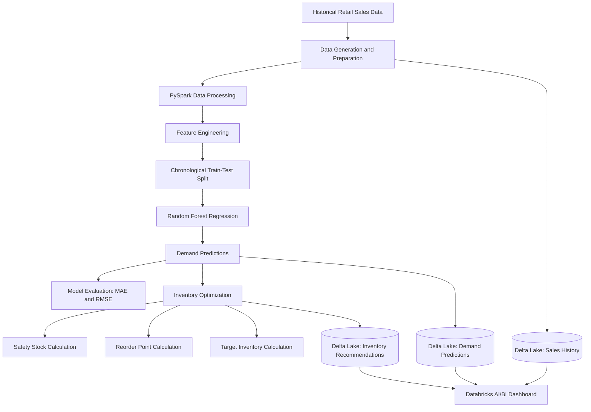

# Project Architecture

## AI Demand Forecasting & Inventory Optimization

### Architecture Diagram

## Architecture Components

### 1. Data Generation
Creates or loads historical retail sales records containing product and date information with sales quantities.

### 2. Data Processing
Uses PySpark to prepare the data for analysis, handle data types, and organize sales records.

### 3. Feature Engineering
Creates useful prediction features from historical patterns, such as day of week, month, weekend indicator, lagged sales, and rolling averages.

### 4. Model Training
Uses Spark MLlib Random Forest Regression to learn relationships between historical sales features and product demand.

### 5. Demand Forecasting
Generates demand predictions for the relevant products and dates defined in the notebook.

### 6. Model Evaluation
Uses MAE and RMSE to measure prediction error against actual demand in the test dataset.

### 7. Inventory Optimization
Uses forecast demand and configured inventory planning assumptions to calculate safety stock, reorder points, and target inventory.

### 8. Delta Lake Storage
Stores sales history, demand predictions, and inventory recommendations in Delta tables for reuse and analysis.

### 9. Dashboard and Reporting
Uses Databricks AI/BI dashboards to present forecasts, inventory levels, and recommendations in an understandable format.

## Data Flow

The system transforms sales data into forecasting features, trains a machine learning model, produces demand predictions, calculates inventory recommendations, and makes the results available for dashboard reporting.

**Note:** This diagram represents the intended project workflow. Update the diagram if the final notebook implements a different sequence or additional components.